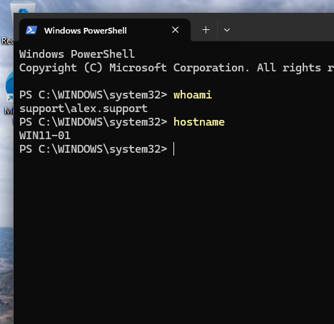
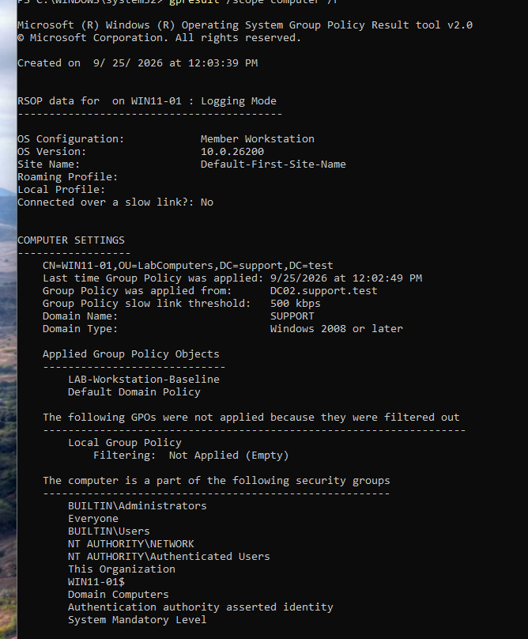
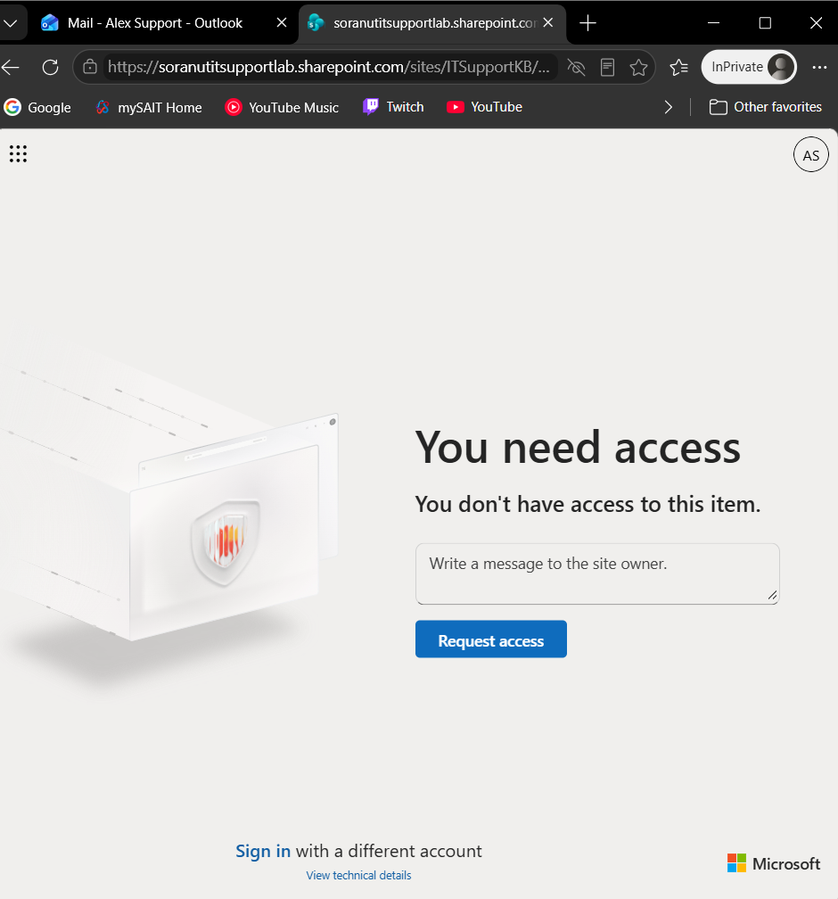
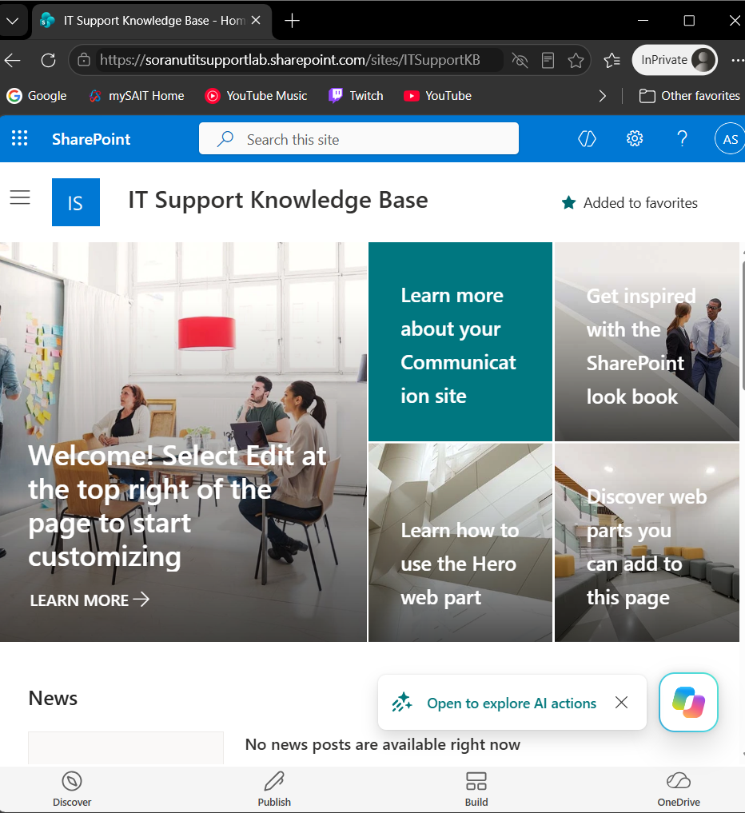
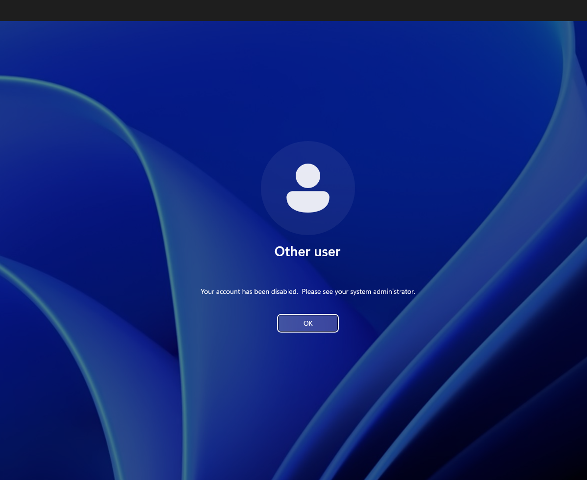
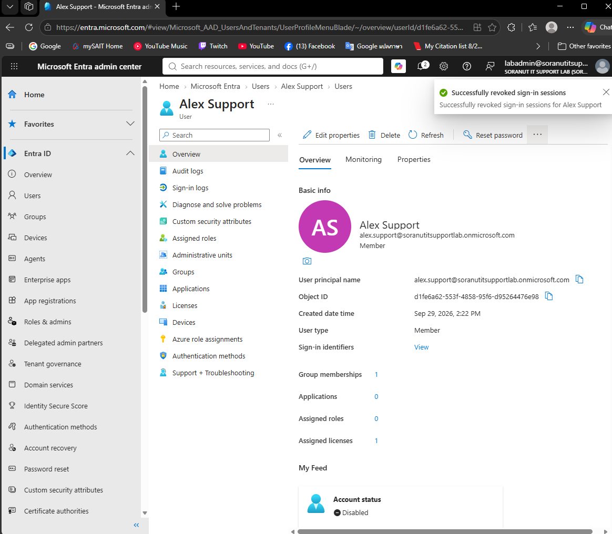

# Microsoft 365 & Active Directory Identity Lifecycle Lab

An independent home lab demonstrating Windows domain administration,
Microsoft 365 user support, access troubleshooting, and simulated
employee offboarding.

## Project Objective

Practice provisioning user accounts, assigning access, troubleshooting
sign-in problems, and removing access across separate Active Directory
and Microsoft 365 environments.

## Lab Environment

| Component | Configuration |
|---|---|
| Virtualization | Oracle VirtualBox |
| Domain controller | DC02 — Windows Server 2025 |
| Workstation | WIN11-01 — Windows 11 |
| AD domain | support.test |
| Network | 10.77.0.0/24 |
| Domain controller IP and DNS | 10.77.0.10 |
| Workstation IP | 10.77.0.20 |
| Cloud services | Microsoft 365, Entra ID, Outlook, SharePoint |

The AD and Microsoft 365 accounts were administered separately.
Directory synchronization was not configured.

## Work Completed

### Active Directory and Windows
- Installed and configured AD DS and DNS.
- Joined a Windows 11 workstation to the domain.
- Configured 3 test users, security groups, and organizational units.
- Applied a workstation baseline Group Policy.
- Practiced password resets and required password changes.
- Resolved Remote Desktop authorization through group membership.

### Microsoft 365 and Entra ID
- Provisioned and licensed a cloud test account.
- Verified access to Outlook.
- Registered Microsoft Authenticator and reviewed Security Defaults.
- Reviewed sign-in records and performed a cloud password reset.
- Tested SharePoint access before and after granting visitor permission.

### Simulated Offboarding
- Disabled the AD test account.
- Blocked cloud sign-in and submitted session revocation.
- Removed SharePoint visitor access.
- Captured rejected fresh sign-in attempts for the restricted accounts.

## Troubleshooting Examples

| Problem | Corrective action |
|---|---|
| Client DNS queries failed | Corrected a duplicate IP address and subnet mask, then verified internal DNS resolution |
| Remote Desktop login was denied | Added the domain access group to the workstation's Remote Desktop Users group |
| SharePoint testing used the wrong identity | Repeated the test using the intended standard-user browser session |

## Validation and Limitations

- Verified domain sign-in, DNS service discovery, and applied Group Policy.
- Captured successful access after permission changes and rejected sign-ins after account restrictions.
- Authenticator registration was verified; the inspected sign-in did not prove an MFA challenge.
- The inactivity policy was applied, but exact elapsed lock timing was not independently recorded.
- Offboarding covered specific account and access restrictions; complete license and group cleanup was not demonstrated.
- This was an educational lab, not a production deployment.

## Skills Demonstrated

Active Directory, DNS, Group Policy, Windows troubleshooting,
Microsoft 365 administration, Entra ID, access permissions,
identity lifecycle management, and technical documentation.

## Final Report

[Read the final project report](Microsoft_365_AD_Project_Final_Report.pdf)

Includes the lab design, configuration, validation results,
troubleshooting, limitations, and 29 selected evidence screenshots.

## Selected Technical Evidence

These screenshots are extracted from the final report. Local AD and cloud identities were administered separately. Click an image to open it at full size.

### Domain sign-in

Commands identify support\alex.support on WIN11-01.

*Report page 15, Figure 6.*

### Applied Group Policy

The computer policy results list LAB-Workstation-Baseline as applied. This verifies policy application, not the exact elapsed lock time.

*Report page 16, Figure 8.*

### SharePoint access before permission

The test user is denied site access before visitor permission is granted.

*Report page 24, Figure 22.*

### SharePoint access after permission

The direct site URL opens in the test-user context after the visitor grant. This test establishes site access, not file-edit permissions.

*Report page 24, Figure 23.*

### AD offboarding validation

A fresh Windows sign-in is rejected because the AD account is disabled.

*Report page 25, Figure 25.*

### Cloud offboarding action

Entra confirms that sign-in sessions were revoked and displays the account as disabled. One license and one group membership remain; this is not evidence of complete entitlement cleanup or immediate invalidation of every application session.

*Report page 26, Figure 27.*

